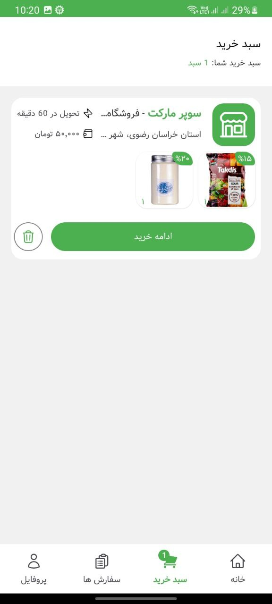
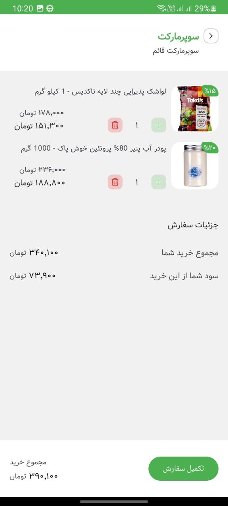
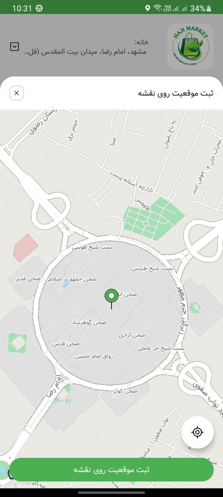
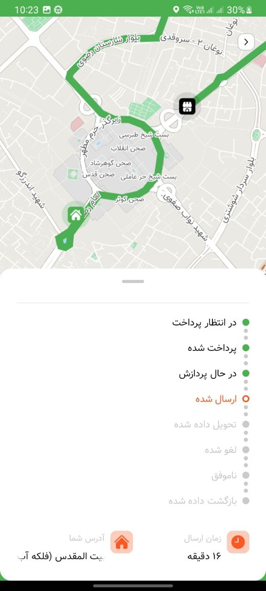
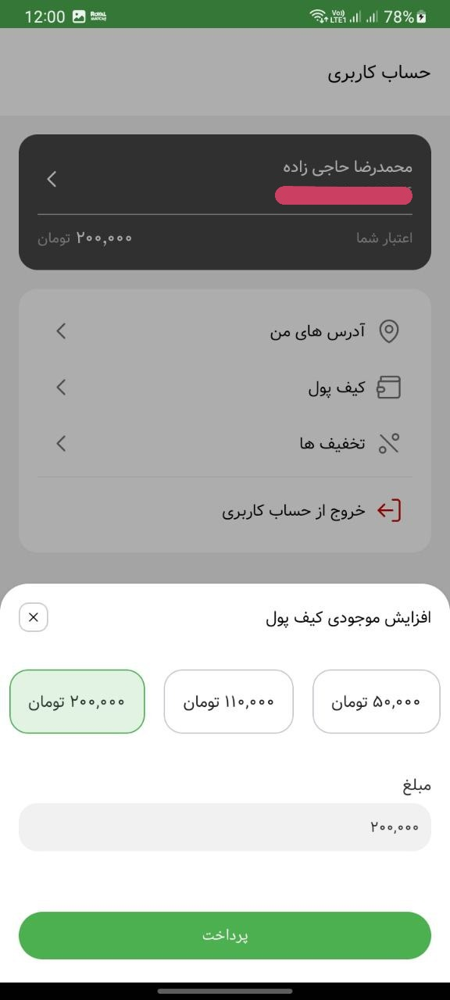
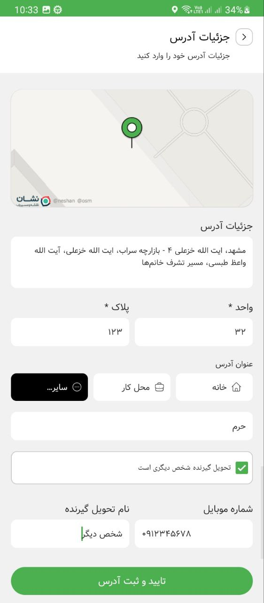
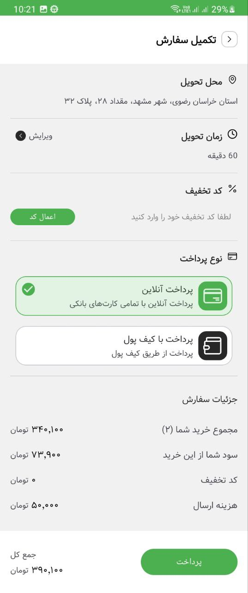

# 🛒 Market - Android E-Commerce Application


**Market** is a full-featured, modern Android e-commerce mobile application built with **Kotlin** following **MVVM Architecture**. It provides a seamless shopping experience including phone OTP authentication, interactive map location picker, dynamic product listing with headers & categories, shopping cart management, wallet top-up, discounts, payment gateway integration, and real-time order tracking.

---

## 📸 Screenshots

| Home Screen | Product Details | Cart Management | Cart Overview |
| :---: | :---: | :---: | :---: |
|  |  |  |  |

| Address & Map | Order Tracking | Wallet | Profile & Settings |
| :---: | :---: | :---: | :---: |
|  |  |  |  |

<details>
  <summary><b>📱 View Additional App Screens</b></summary>
  <br>

  | Address List | Map Location Picker | Change Address | Discount Codes |
  | :---: | :---: | :---: | :---: |
  |  |  |  |  |

  | Payment Flow | Order History | Edit Profile |
  | :---: | :---: | :---: |
  |  |  |  |
</details>

---

## ✨ Features

- **📲 Phone OTP Authentication:** Fast and secure SMS-based user authentication with automatic SMS Retriever API integration.
- **🗺️ Interactive Map & Location Picker:** Integrated **Neshan Map SDK** for choosing precise delivery addresses, reverse geocoding, and static map previews.
- **🛍️ Dynamic Market Showcase:** Banner image sliders, category filters, nearby shops, discounted items, and popular product feeds.
- **🛒 Smart Shopping Cart:** Quantity increment/decrement, real-time price calculation, and discount coupon application.
- **💳 Payment & Wallet System:** Integrated payment gateway web view and in-app wallet balance management.
- **🚚 Live Order Tracking:** Real-time route rendering and order status tracking powered by Neshan Direction API.
- **👤 User Profile & Address Book:** Manage saved addresses, active shipping address selection, and personal profile information.
- **✨ Shimmer Loading Effects:** Skeleton loading indicators (Koleton) during network requests for enhanced UX.

---

## 🛠 Tech Stack & Architecture

- **Language:** [Kotlin](https://kotlinlang.org/)
- **Architecture Pattern:** MVVM (Model-View-ViewModel) + Repository Pattern
- **UI & Layouts:** Material Design 3, XML Layouts, ViewBinding
- **Networking:** [Retrofit 2](https://square.github.io/retrofit/) + [Gson](https://github.com/google/gson)
- **Map & Location Services:** [Neshan Android Map SDK](https://platform.neshan.org/) & Direction Services
- **Image Loading:** [Glide](https://github.com/bumptech/glide)
- **State & Lifecycle Management:** LiveData & ViewModel (Android Jetpack)
- **UI Effects:** Koleton Skeleton Shimmer Loading

---

## 📂 Project Structure

```
market/
 └── app/src/main/java/com/se7en/market/
      ├── Activity/           # App Activities (Splash, Main, Login, Cart, Map, OrderStatus, etc.)
      │    └── Ui/            # BottomSheets & Custom UI Modals
      ├── Adapter/            # RecyclerView Adapters (Product, Cart, Address, Order, Slider, etc.)
      ├── Fragment/           # App Fragments (Home, AddressList, Orders, Pay, Profile, Map, etc.)
      ├── Model/              # Data Models & Entities
      ├── Network/            # Retrofit API Service & Network Response Handlers
      ├── Repository/         # Repositories for Data Sources & Preferences
      ├── Response/           # Network Response DTOs
      ├── Utils/              # Helper utilities, Constants, CartManager, SMS Receiver
      └── ViewModel/          # Jetpack ViewModels (HomeViewModel, CartViewModel, ProfileViewModel, etc.)
```

---

## 🚀 Getting Started

### Prerequisites

- Android Studio Hedgehog (2023.1.1) or newer
- JDK 17
- Android SDK API 34 (Compiled) / Minimum SDK 24 (Android 7.0)

### Installation & Setup

1. **Clone the Repository:**
   ```bash
   git clone https://github.com/your-username/market.git
   cd market
   ```

2. **Configure API Keys & Base URL:**
   - Open `com/se7en/market/Utils/Constance.kt` and set your server base URL:
     ```kotlin
     const val BASE_URL = "https://your-api-domain.com/"
     ```
   - Open `com/se7en/market/Network/ApiService.kt` and insert your Neshan API Key:
     ```kotlin
     @Headers("Api-Key: YOUR_NESHAN_API_KEY")
     ```
   - Configure `YOUR_NESHAN_API_KEY` in `OrderStatusActivity.kt` and `DetailsAddressActivity.kt`.

3. **Build and Run:**
   - Sync project with Gradle files.
   - Build and run on an Android Emulator or physical device.

---

## 🔐 Security Notice

All sensitive production API keys, tokens, and keystore passwords have been sanitized and replaced with placeholder variables (`YOUR_NESHAN_API_KEY`, `https://your-api-domain.com/`). Make sure to provide your own API keys when running the application locally.
